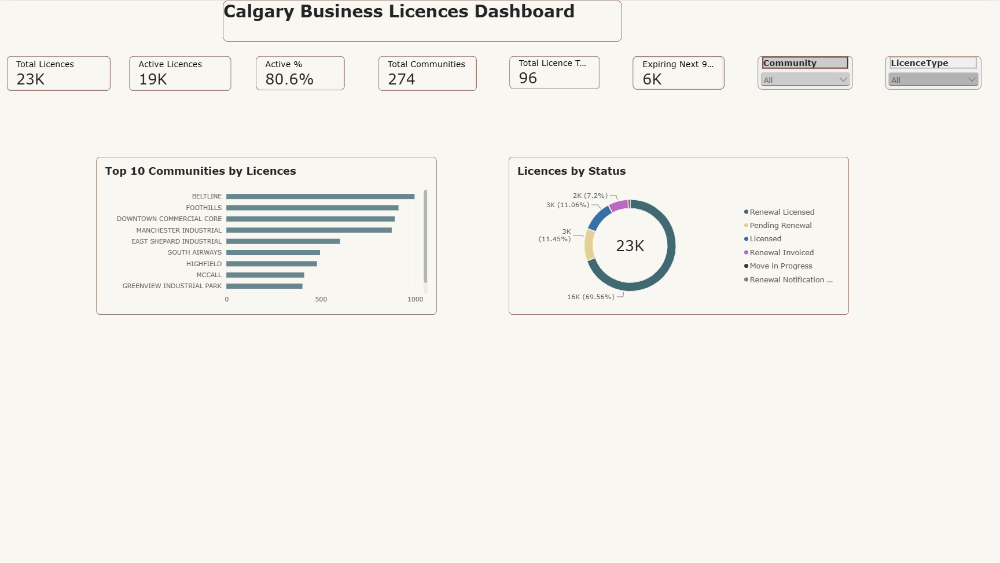
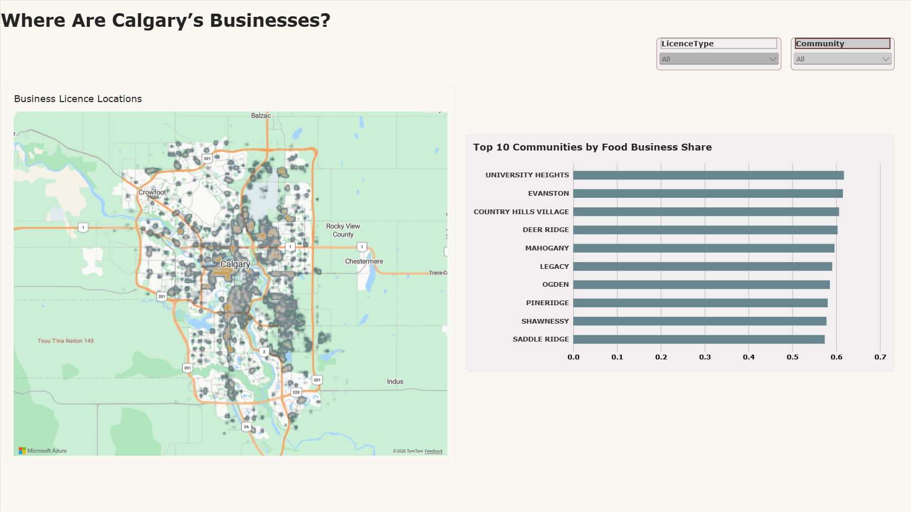
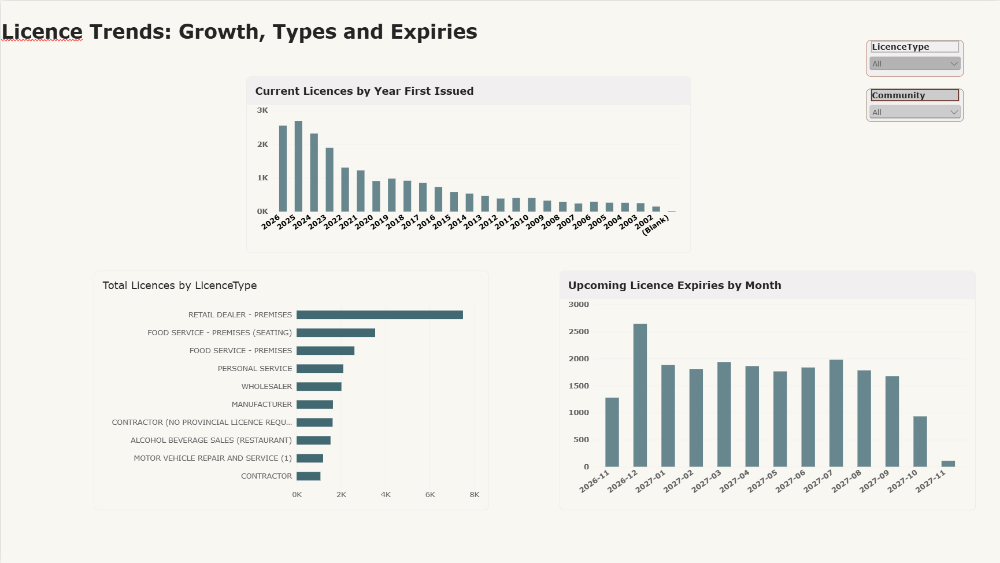

# Calgary Business Licences – BI Portfolio Project

An end-to-end Business Intelligence project using City of Calgary Open Data. The data was cleaned in **Excel Power Query**, loaded into **SQL Server**, and visualized in a three-page **Power BI** dashboard that shows where Calgary's businesses are, what types they are, and how licences change over time.



---

## Business Questions

1. How many business licences are there in Calgary, and how many are active?
2. Which communities have the most licensed businesses?
3. Where are businesses located across the city, and where do food businesses make up the largest share?
4. Which licence types are most common?
5. How has the number of new licences changed over the years?
6. How many licences expire in the coming months? (This matters for renewal workload planning.)

---

## Data Source

- **Dataset:** City of Calgary Open Data – Business Licences
- **Size:** 23,192 rows, 12 columns
- **Key fields:** trade name, address, community (COMDISTNM / COMDISTCD), licence types, job status, first issued date, expiry date, location (POINT)

---

## Tools Used

| Tool | Purpose |
|---|---|
| Excel Power Query | Data profiling and cleaning |
| SQL Server (SSMS) | Database storage and SQL analysis (`CalgaryBusinessLicensesDB`) |
| Power BI Desktop | Data model, DAX measures, interactive dashboard |
| DAX | KPIs and calculated measures |

---

## Data Cleaning (Power Query)

- Profiled the full dataset (column quality, distribution, profile)
- Converted `FIRST_ISS_DT` and `EXP_DT` to **Date** type
- Trimmed text columns and removed double spaces in `TRADENAME`
- Replaced line breaks in `LICENCETYPES` with spaces
- Replaced `"="` values in `COMDISTCD` with null
- Kept 12 repeated `GETBUSID` values, because they are valid "Move in Progress" pairs (not true duplicates)
- Split `POINT` into **Longitude** and **Latitude** for mapping
- Removed the `HOMEOCCIND` column (not needed for analysis)

---

## SQL (SQL Server / SSMS)

Database: `CalgaryBusinessLicensesDB`

| File | What it does |
|---|---|
| `01_create_table.sql` | Creates `calgary_business_licenses_clean` (13 columns, cleaned data) |
| `02_vw_LicenceTypes.sql` | Splits comma-separated licence types into one row per type (`CROSS APPLY STRING_SPLIT`) |
| `03_vw_CommunitySummary.sql` | Total and food businesses per community (`GROUP BY`, `CASE WHEN`) |
| `04_analysis_queries.sql` | Queries answering the business questions and checking Power BI numbers |

Note: a business with several licence types appears once per type in `vw_LicenceTypes`, so licence type totals add up to more than the number of businesses.

---

## Data Model

- **BusinessLicences**: main fact table
- **vw_LicenceTypes**: SQL view splitting licences by licence type
- **datetable**: date table (Date, Month, Month Number, Year, Year-Month)
- **_Measures**: table holding all DAX measures

### DAX Measures

| Measure | What it calculates |
|---|---|
| Total Licences | Count of all licence rows |
| Active Licences | Licences with status "Licensed" or "Renewal Licensed" |
| Active % | Active Licences ÷ Total Licences |
| Total Communities | Number of distinct communities |
| Total Licence Types | Number of distinct licence types (from `vw_LicenceTypes`) |
| Expiring Next 90 Days | Licences expiring between today and 90 days from today |
| Expiries | Licences by expiry date, using an inactive relationship (`USERELATIONSHIP`) to the date table |
| Food Licences | Licences whose types include "FOOD SERVICE" |
| Food Share % | Food Licences ÷ Total Licences |
| Food Share % (50+) | Food Share % for communities with 50+ licences only |

Example:

```DAX
Food Share % (50+) =
IF ( [Total Licences] >= 50, [Food Share %] )
```

`Food Share % (50+)` stops very small communities (e.g. 1 licence = 100% food) from taking over the Top 10 ranking. A normal visual filter didn't work here because Power BI applies the Top N filter first. All formulas are in `powerbi/dax_measures.dax`.

---

## Dashboard Pages

### 1. Overview – Calgary Business Licences Dashboard
- KPI cards: **23K total licences**, **19K active**, **80.6% active**, **274 communities**, **96 licence types**, **6K expiring in the next 90 days**
- Top 10 Communities by Licences
- Licences by Status (donut)
- Slicers: Community, Licence Type


### 2. Map – Where Are Calgary's Businesses?
- Heat map of business licence locations (Latitude/Longitude)
- Top 10 Communities by Food Business Share (communities with 50+ licences)



### 3. Trends
- Current Licences by Year First Issued (excludes 2001 placeholder dates; 2026 is year-to-date)
- Licences by Licence Type
- Upcoming Licence Expiries by Month (next 12 months)



---

## Key Insights

- **About 81% of licences are active**, and most are in "Renewal Licensed" status (about 70%).
- **Beltline** has the most licences of any community, followed by Foothills, Downtown Commercial Core and Manchester Industrial. Business activity is concentrated in the inner city and industrial areas.
- **Retail Dealer – Premises** is by far the most common licence type, followed by food service licences.
- Most current licences were **first issued recently (2022–2025)**. Older licences drop off steadily, which suggests high business turnover.
- **December 2026 is the peak month for expiries**. That's useful for planning renewal staffing and reminders.
- About **6K licences expire in the next 90 days**.

---

## Repository Structure

```
Calgary-Business-Licences/
├── data/        # Raw and cleaned data files
├── powerbi/     # .pbix file and DAX measures
├── sql/         # SQL scripts (table creation, views, analysis queries)
├── images/      # Dashboard screenshots
└── README.md
```

The `powerbi/` folder holds the `.pbix` file and `dax_measures.dax`.

---

## How to Use

1. Download the `.pbix` file from the `powerbi/` folder.
2. Open it in **Power BI Desktop** (free).
3. Use the **Community** and **Licence Type** slicers to explore the data.
4. Or view the dashboard screenshots in `images/` without installing anything.

---

## Author

**Asma Ahmed**
Business Intelligence and Data Analysis Reporting student, SAIT, Calgary
Master of Digital Innovation (Digital Business), Dalhousie University

LinkedIn: [linkedin.com/in/asmaahk](https://www.linkedin.com/in/asmaahk/)
